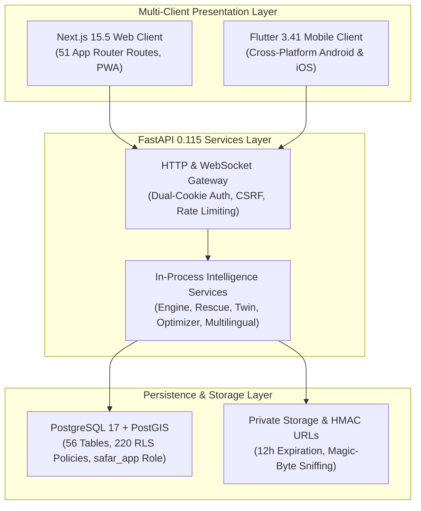
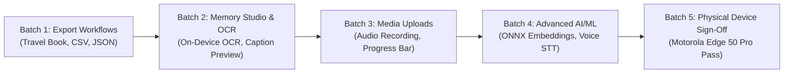

# SAFAR — Comprehensive Project Status & Accomplishments Report
**The Living Journey Network** — *Every Person. Every Moment. One Intelligent Journey.*

**Date:** 2026-11-22  
**Current Release Target:** SAFAR 1.0.0  
**Current Git Baseline:** `dba0610` (Branch: `master`)  
**Core Architectural Rule:** *The Engine Recommends, The Group Decides.*

---

## Executive Summary

SAFAR is a privacy-first, collaborative travel platform built as a synchronized multi-client system:
- **Backend API:** FastAPI 0.115 + SQLAlchemy 2.0 + Pydantic 2.10 + Alembic.
- **Web Client:** Next.js 15.5 (App Router) + React 19.3 + TypeScript 5.7 (strict) + Tailwind CSS 3.4.
- **Mobile Client:** Flutter 3.41 (Dart 3.11) + Riverpod 2.6 + GoRouter 17 + Dio 5 (Android & iOS).
- **Database Architecture:** Dual-database posture with SQLite for local regression testing, and PostgreSQL 17 (Supabase-compatible) for staging and production, protected by PostgreSQL Row-Level Security (RLS) across all 56 tables (220 policies) under an unprivileged `safar_app` role.
- **Intelligence Philosophy:** 100% deterministic, grounded, and privacy-preserving. Zero dependency on third-party generative LLMs or hallucinated travel data. Every prediction or suggestion carries an explicit provenance tag (`VERIFIED`, `CURATED`, `REPORTED`, `ESTIMATED`, `PREDICTED`).

Every single one of the **49 Master Features (F01–F49)** defined in [SAFAR_MASTER_SPECIFICATION.md](file:///c:/Users/siddharth/Desktop/SAFAR-1/SAFAR_MASTER_SPECIFICATION.md) has been implemented and connected end-to-end across backend APIs, web routes, and mobile screens.

---

## 1. Monorepo Architecture & Technology Stack

| Layer | Technology & Version | Purpose & Invariants |
| :--- | :--- | :--- |
| **Backend API** | FastAPI 0.115, SQLAlchemy 2.0, Pydantic 2.10, PyJWT, Uvicorn | 121 OpenAPI endpoints, 150+ operations, dependency-injected services, structured JSON logging, strict payload validations. |
| **Web Frontend** | Next.js 15.5.29, React 19.3.1, TypeScript 5.7 (strict), Tailwind CSS 3.4 | 51 routes under `app/(app)`, TanStack Query 5, Zustand 5, Framer Motion, Leaflet + OpenStreetMap, PWA service worker. |
| **Mobile Client** | Flutter 3.41.4, Dart 3.11.0, Riverpod 2.6.1, GoRouter 17, Dio 5 | Material 3 custom editorial design system, `SafarCookieJar` in secure storage, offline queue in SharedPreferences, Android API 21–36. |
| **Database** | SQLite (Dev/Test) / PostgreSQL 17.12 (Staging/Prod) | Dedicated non-owner role `safar_app`, RLS enabled on 56/56 tables (55 forced), 220 policies, fail-closed isolation. |
| **Migrations** | Alembic (SQLAlchemy) | Revision `e5c8a2b7d940` committed at head. Zero pending schema differences (`alembic check` clean). |
| **Realtime** | In-process WebSocket Hub (`/ws/trips/{id}`) | Ticket-authenticated per-trip channels for instant proposal, voting, and itinerary updates. |
| **Testing** | Pytest, Vitest, Flutter Test | 132 backend tests, 12 web unit tests, 61 mobile tests, 12 live API integration tests. |

---

## 2. Complete Master Feature Registry (F01–F49)

All 49 features are cataloged below with their operational audit status, backend routes, mobile screens, and web routes:

| ID | Feature Name | Category | Backend Route / Service | Mobile Screen | Web Route | Status |
| :---: | :--- | :--- | :--- | :--- | :--- | :---: |
| **F01** | Account, Consent & Preferences | Foundation | `routers/auth.py`, `users.py` | `SettingsScreen`, `ProfileScreen` | `/profile`, `/settings` | **PARTIAL** |
| **F02** | Journey DNA | Foundation | `GET/PUT /api/me/dna` | `ProfileScreen` (DNA) | `/profile` | **COMPLETE** |
| **F03** | Destination & Activity Discovery | Foundation | `routers/places.py`, `destinations.py` | `DiscoveryScreen` | `/discover`, `/discover/[id]` | **COMPLETE** |
| **F04** | Trip Creation, Roster & Roles | Foundation | `routers/trips.py` | `PeopleInvitesScreen` | `/trips/[id]/members` | **COMPLETE** |
| **F05** | Collaborative Itinerary & Voting | Foundation | `routers/itinerary.py`, `voting.py` | `ItineraryScreen`, `VotingScreen` | `/trips/[id]/itinerary`, `/voting` | **COMPLETE** |
| **F06** | Trip Pulse | Foundation | `routers/trips.py` (`/pulse`) | `PulseScreen` | `/trips/[id]/pulse` | **COMPLETE** |
| **F07** | Group Experience Engine | Intelligence | `services/engine.py` | `EngineScreen` | `/trips/[id]/engine` | **COMPLETE** |
| **F08** | Trip Twin | Intelligence | `routers/twin.py` | `TwinScreen` | `/trips/[id]/twin` | **COMPLETE** |
| **F09** | Trip Rescue & Autopilot | Intelligence | `services/rescue.py` | `RescueScreen` | `/trips/[id]/rescue` | **COMPLETE** |
| **F10** | Maps & Nearby Experiences | Trust & Map | `services/places.py` (`/nearby`) | `NearbyScreen`, `SlippyMap` | `/trips/[id]/map` | **COMPLETE** |
| **F11** | Shared Memory Timeline | Memory | `routers/memories.py` | `MemoriesScreen` | `/trips/[id]/memories` | **PARTIAL** |
| **F12** | AI Memory Studio | Memory | `services/memory.py` | `StudioScreen` | `/trips/[id]/memories/studio` | **PARTIAL** |
| **F13** | Group Expenses & Settlement | Governance | `routers/expenses.py` | `ExpensesScreen` | `/trips/[id]/expenses` | **PARTIAL** |
| **F14** | Place Pulse & Observations | Trust | `services/places.py` | `PlaceDetailScreen` | `/trips/[id]/places/[id]` | **COMPLETE** |
| **F15** | Serendipity Radar | Discovery | `services/discovery.py` | `ConnectionsScreen` | `/connections` | **COMPLETE** |
| **F16** | Travel Circles & Local Contributors | Trust | `routers/circles.py` | `CirclesScreen`, `ContributorsScreen` | `/circles`, `/contributors` | **COMPLETE** |
| **F17** | Dream-to-Destination Import | Discovery | `services/discovery.py` | `ImportScreen` | `/trips/[id]/inspirations` | **PARTIAL** |
| **F18** | Journey Replay & Travel Book | Memory | `routers/memories.py` (`/replay`) | `ReplayScreen` | `/trips/[id]/memories/replay` | **BROKEN** |
| **F19** | Travel Missions & Wildcards | Governance | `routers/missions.py` | `MissionsScreen` | `/trips/[id]/missions` | **COMPLETE** |
| **F20** | Offline-First Capture & Sync | Resilience | `routers/memories.py` (`/sync`) | `OfflineSyncScreen`, `OfflineQueue`| `/trips/[id]/offline` | **COMPLETE** |
| **F21** | Predictive Crowd Forecasting | Intelligence | `services/places.py` | `PlaceDetailScreen` | `/trips/[id]/places/[id]` | **COMPLETE** |
| **F22** | Multilingual Grounded Conversation | Intelligence | `services/assistant.py` | `AssistantScreen` | `/trips/[id]/assistant` | **COMPLETE** |
| **F23** | Journey Pact | Governance | `routers/trips.py` (`/pact`) | `PactScreen` | `/trips/[id]/pact` | **COMPLETE** |
| **F24** | Opportunity Clock | Intelligence | `services/opportunity.py` | `OpportunityScreen` | `/trips/[id]/opportunity` | **COMPLETE** |
| **F25** | Shadowplan | Governance | `routers/shadowplans.py` | `PlanIntelligenceScreen` | `/trips/[id]/insights` | **COMPLETE** |
| **F26** | One-Link Companion | Governance | `routers/companion.py` | `CompanionScreen`, `CompanionPublicScreen` | `/companion/[token]` | **COMPLETE** |
| **F27** | Planner Load Balancer | Governance | `routers/trips.py` (`/tasks`) | `TasksScreen` | `/trips/[id]/tasks` | **COMPLETE** |
| **F28** | Branch & Rejoin | Governance | `routers/branches.py` | `BranchesScreen` | `/trips/[id]/branches` | **COMPLETE** |
| **F29** | Journey Effort Budget | Intelligence | `services/optimizer.py` | `PlanIntelligenceScreen` | `/trips/[id]/insights` | **COMPLETE** |
| **F30** | Decision Evidence Passport | Trust | `services/places.py` | `PlaceDetailScreen` | `/trips/[id]/places/[id]` | **COMPLETE** |
| **F31** | Ask the Ground | Trust | `routers/ground.py` | `GroundScreen` | `/trips/[id]/ground` | **COMPLETE** |
| **F32** | Cost-Shock Guard | Governance | `services/impact.py` | `VotingScreen`, `ProposalsScreen` | `/trips/[id]/voting` | **COMPLETE** |
| **F33** | Outcome Calibrator | Intelligence | `services/feedback.py` | `PlaceDetailScreen` | `/trips/[id]/places/[id]` | **COMPLETE** |
| **F34** | Journey Capsule | Memory | `routers/capsules.py` | `PlanIntelligenceScreen` | `/trips/[id]/insights` | **COMPLETE** |
| **F35** | Constraint Compass | Intelligence | `routers/trips.py` (`/pulse`) | `PulseScreen` | `/trips/[id]/pulse` | **COMPLETE** |
| **F36** | One Question That Matters | Intelligence | `services/engine.py` | `EngineScreen` | `/trips/[id]/engine` | **COMPLETE** |
| **F37** | Journey Fragility Radar | Intelligence | `services/optimizer.py` | `PlanIntelligenceScreen` | `/trips/[id]/insights` | **COMPLETE** |
| **F38** | Domino Map | Intelligence | `services/optimizer.py` | `PlanIntelligenceScreen` | `/trips/[id]/insights` | **COMPLETE** |
| **F39** | Protected Wander Window | Governance | `services/schedule.py` | `ItineraryScreen`, `EngineScreen` | `/trips/[id]/itinerary` | **COMPLETE** |
| **F40** | Expectation Reality Check | Trust | `services/places.py` | `PlaceDetailScreen` | `/trips/[id]/places/[id]` | **COMPLETE** |
| **F41** | Door-to-Door Access Chain | Trust | `services/places.py` | `PlaceDetailScreen` | `/trips/[id]/places/[id]` | **COMPLETE** |
| **F42** | Discovery Balance Lens | Discovery | `services/ranking.py` | `DiscoveryScreen` | `/discover` | **COMPLETE** |
| **F43** | Graceful Independent Time | Governance | `routers/itinerary.py` | `ItineraryScreen` | `/trips/[id]/itinerary` | **COMPLETE** |
| **F44** | Material Change Watch | Trust | `routers/watch.py` | `WatchScreen` | `/trips/[id]/watch` | **COMPLETE** |
| **F45** | Fair Trade Negotiator | Intelligence | `routers/twin.py` | `NegotiateScreen`, `TwinScreen` | `/trips/[id]/twin` | **COMPLETE** |
| **F46** | Local Context Requests | Trust | `routers/ground.py` | `GroundScreen` | `/trips/[id]/ground` | **COMPLETE** |
| **F47** | Journey Thread | Foundation | `routers/users.py` | `ThreadScreen` | `/thread` | **COMPLETE** |
| **F48** | Neighborhood Respect Filter | Trust | `services/engine.py`, `places.py`| `EngineScreen`, `PlaceDetailScreen`| `/trips/[id]/engine` | **COMPLETE** |
| **F49** | Decision Load Governor | Governance | `routers/users.py` | `DashboardScreen` | `/dashboard` | **COMPLETE** |

---

## 3. Detailed Chronological Milestone History (Phases 1 to 14)

### Phases 1–4: Core Foundation & Web Reference App
- Implemented full FastAPI architecture with 121 OpenAPI routes and SQLite local development.
- Built all Next.js 15.5 App Router web pages, layouts, and responsive desktop/mobile components.
- Structured core models: `User`, `Trip`, `TripMember`, `Itinerary`, `ItineraryItem`, `Proposal`, `Vote`, `TripPulse`, `Expense`, `Memory`, `Activity`, `Place`.
- Engineered initial backend test suite (49 tests) covering basic CRUD, proposal gating, and rule assertions.

### Phase 5: PostgreSQL Database & Row-Level Security
- Migrated data layer to PostgreSQL target with full Alembic migration history.
- Authored migration `d9e4f1b2c305_row_level_security.py` enabling RLS across all domain tables.
- Implemented fail-closed security invariants: queries lacking session context return 0 rows.
- Established unprivileged database user architecture separating runtime queries from migration DDL.

### Phases 6–7: Editorial Design System & Deterministic AI Core
- Designed and codified the SAFAR Editorial Design System (`docs/UI_DESIGN.md`): Lora serif display headings, system sans body, ember/jade/rose palette, and strict trust badges.
- Built **Group Experience Engine v1.5** (`services/engine.py`):
  - Rawlsian Maximin (*Everyone Wins*), Inclusion Equity (*Your Turn*), and Novelty Exploration (*Surprise Us*).
  - Jain's Fairness Index computation ($J \ge 0.85$).
  - Maximal Marginal Relevance (MMR) diversity reranking ($\lambda = 0.15$).
- Built **Predictive Crowd Forecasting v2** (`services/places.py`):
  - Median Absolute Deviation (MAD) outlier rejection.
  - 180-day exponential recency decay weighting.
  - Transparent `insufficient_data` handling when fewer than 8 observations exist.
- Built **Multilingual Grounded Assistant v2** (`services/assistant.py`):
  - 8-language support (EN, ES, FR, DE, PT, IT, HI, JA) with script detection.
  - Grounded trip context injection with citations.
  - Absolute disclosure: `external_llm: false`.

### Phases 8–12: Complete Mobile Client Migration (Flutter)
- Created `apps/mobile` powered by Flutter 3.41 / Dart 3.11 with Riverpod 2.6 and GoRouter 17.
- Re-implemented all 49 feature screens natively in Dart, matching the editorial web design system.
- Built custom `SafarCookieJar` in `flutter_secure_storage` to preserve HttpOnly cookies and CSRF tokens across mobile sessions.
- Added offline mutation queue in SharedPreferences with client UUID generation and idempotent server sync.
- Configured Android build pipelines (Gradle KTS, targetSdk 36, minSdk 21) and compiled verified release APK and AAB bundles.
- Expanded automated tests: 61 Flutter unit/widget tests covering usability, themes, text scaling, and offline handling.

### Phase 13: Controlled Pilot & Real-World Validation
- **Step 1 (Staging Setup):** Deployed local staging on port `8020` connected to dedicated Supabase PostgreSQL 17 instance.
- **Step 2 (App Role & Pooler):** Configured unprivileged `safar_app` role (`NOSUPERUSER`, `NOBYPASSRLS`) via Supabase IPv4 session pooler.
- **Step 3 (RLS Verification):** Verified all 56 tables have RLS enabled (55 forced) with 220 policies.
- **Step 4 (Multi-User Pilot):** Executed Journeys A through F with 5 personas (Mira, Jonas, Aiko, Leo, Noor), verifying collaborative itinerary voting, accessibility filtering, and expense settlements.
- **Step 5 (Stress Testing):** Tested network failure recovery, offline sync idempotency, race condition handling, and refresh token theft detection.
- **Step 6 (Observability & Backups):**
  - Added structured JSON logging (`JsonFormatter`) with automated sensitive data redaction.
  - Added thread-safe in-memory operational metrics (`MetricsCollector`) and alert manager with 5-minute cooldowns.
  - Added dual-probe health checks: `/api/health` (liveness) and `/api/ready` (database readiness).
  - Built automated logical backup script (`backup_staging.py`) creating `pg_dump -Fc` archives with SHA-256 manifests and 7-backup retention.
  - Verified non-destructive restore drill into temporary database `safar_restore_verify`.
- **Step 7 (Readiness Assessment):** Delivered comprehensive Production Readiness Report (`docs/PHASE13_STEP7_PRODUCTION_READINESS_REPORT.md`) and Operational Handover Runbook (`docs/SAFAR_RELEASE_HANDOVER.md`).

### Phase 14: Release Baseline & Comprehensive Product Audit
- **Step 1 (Repository Baseline):** Committed official release baseline (`1cd0cea`), hardening `.gitignore` against accidental inclusion of local SQLite DBs, staging dumps, environment files, and user media. Verified clean tree and 100% test pass rate.
- **Comprehensive Functional, AI/ML & Media Audits (`dba0610`):**
  - Conducted end-to-end evaluation connecting Flutter UI $\to$ API $\to$ PostgreSQL $\to$ Physical Motorola Edge 50 Pro.
  - Cataloged exact operational status: **43 Complete, 5 Partial, 1 Broken**.
  - Identified root cause of raw text dumps in modal sheets (Travel Book, CSV export, GDPR export).
  - Created dependency-aware 5-Batch Engineering Roadmap to bring all features to 100% operational completion.

---

## 4. Current Test Suite & Verification Matrix

The repository maintains zero failing tests across all test suites:

| Suite | Target | Test Count / Scope | Result | Coverage Highlights |
| :--- | :--- | :---: | :---: | :--- |
| **Backend Core** | `pytest services/api/tests` | **132 passed** | Clean (100%) | RLS policies, security invariants, engine fairness, rescue rules, multilingual assistant, metrics, and backup restore. |
| **Web Client AST**| `apps/web: npm run typecheck` | Full AST | Clean (0 errors) | Strict TypeScript 5.7 validation across all 51 App Router routes. |
| **Web Client Unit**| `apps/web: npm test` | **12 passed** | Clean (100%) | Vitest tests for Zustand auth store, date/currency utilities, and toast notifications. |
| **Web Client Build**| `apps/web: npm run build` | 51 routes | Clean (Exit 0) | Static optimization and dynamic server route compilation. |
| **Mobile Analyze**| `apps/mobile: flutter analyze` | Entire project | **0 issues** | Dart analyzer reports clean code with 0 errors, warnings, or lints. |
| **Mobile Unit/UI** | `apps/mobile: flutter test` | **61 passed** | Clean (100%) | Unit, widget, usability, dark mode, 150% text scaling, and offline queue tests. |
| **Mobile Live API** | `flutter test test/integration/`| **12 passed** | Clean (100%) | Realtime auth, session refresh, CSRF validation against staging port 8020. |
| **Database RLS** | `verify_postgres_rls.py` | 8 assertions | Clean (100%) | Direct SQL assertions under restricted `safar_app` role; tenant leaks return 0 rows. |
| **Backup Integrity**| `verify_manifest_integrity()` | Manifest dump | Clean (100%) | SHA-256 integrity hash matches physical `.dump` file. |

---

## 5. Security & Privacy Invariants Enforced

1. **Server-Side Data Partitioning:**
   - Private member budgets, accessibility needs, pulse notes, and private memories are filtered server-side. They are never sent over the wire to unauthorized peers.
2. **Deterministic & Safe Mutability:**
   - AI recommendation engines, Trip Rescue, Trip Twin, and Shadowplans **never** write directly to the confirmed itinerary.
   - All plan changes must pass through proposals, member voting, and owner/admin approval gates.
3. **Session & Token Hygiene:**
   - Dual-cookie session architecture: HttpOnly 15-minute `safar_access` and HttpOnly 30-day `safar_refresh`.
   - Single-use refresh token rotation: replaying an invalidated refresh token triggers instant revocation of the entire session family.
4. **CSRF & Upload Protection:**
   - Double-submit CSRF protection on all state-changing cookie requests (`safar_csrf` + `X-CSRF-Token`).
   - Magic-byte sniffing on media uploads rejects disguised executables or spoofed extensions.
   - Uploaded media is served exclusively via expiring HMAC-signed URLs (12h TTL).
5. **Database Row-Level Security:**
   - 56 / 56 tables have RLS enabled (55 forced) under `safar_app`.
   - 220 security policies filter access by session variables (`app.user_id`, `app.admin`, `app.system`).
   - Unauthenticated queries fail closed (return 0 rows).
6. **Production Fail-Safes:**
   - Application refuses to boot (`RuntimeError`) if `ENVIRONMENT=production` and `SECRET_KEY` is default, `CORS_ORIGINS` has `*`, or `COOKIE_SECURE` is false.

---

## 6. Functional Audit Findings & 5-Batch Engineering Roadmap

Recent end-to-end testing against the physical Motorola Edge 50 Pro revealed specific presentation defects where features were functional on the backend, but presented raw strings in the mobile UI instead of real files:

### The Defect Inventory
1. **F18 (F44) Travel Book (BROKEN):** "Open travel book" displays raw HTML source code in `SelectableText` rather than opening a browser or rendering a print document.
2. **F13 Group Expenses CSV (PARTIAL):** "Export CSV" displays raw CSV text in a bottom sheet instead of sharing an actual `.csv` file.
3. **F01 Personal Data Export (PARTIAL):** "Export data" dumps raw JSON into `SelectableText` instead of sharing a `.json` file.
4. **F17 Dream Import (PARTIAL):** "Image" option is missing in Flutter `_ImportSheet`; backend lacks OCR binary.
5. **F11 Shared Memories (PARTIAL):** Mobile lacks video picking, voice note recording, and upload progress cancellation.
6. **F12 Memory Studio (PARTIAL):** Shows disabled badges for image embeddings, OCR, and speech-to-text.

### The 5-Batch Remediation Roadmap

- **Batch 1 (Highest Priority):** Add `path_provider` and `url_launcher` to `pubspec.yaml`. Save Travel Book HTML, Expenses CSV, and User Data JSON to device cache, launching native Android share intents (`SharePlus.shareXFile`) and browser views.
- **Batch 2:** Add "Image" picker to Dream Import; integrate `google_mlkit_text_recognition` in Flutter for instant on-device OCR; connect caption suggestion previews.
- **Batch 3:** Add in-app audio recording for voice memories; wire `Dio` upload progress bars and `CancelToken`.
- **Batch 4:** Integrate lightweight ONNX visual feature extractor for photo similarity; add Android speech-to-text transcription.
- **Batch 5:** End-to-end verification pass on physical Motorola Edge 50 Pro; update documentation and registries.

---

## 7. Active Environment & Repository Guide

### Running Services
- **Web Development Server:** `http://localhost:3000` (PID 50400)
- **API Development Server:** `http://127.0.0.1:8000` (PID 49740)
- **Staging API Daemon:** `http://127.0.0.1:8020` (PID 51932, Supabase PostgreSQL 17)

### Key Project Documentation Index
- Master Specification: [SAFAR_MASTER_SPECIFICATION.md](file:///c:/Users/siddharth/Desktop/SAFAR-1/SAFAR_MASTER_SPECIFICATION.md)
- Complete Feature Registry: [docs/FEATURE_REGISTRY.md](file:///c:/Users/siddharth/Desktop/SAFAR-1/docs/FEATURE_REGISTRY.md)
- Comprehensive Functional Audit: [docs/COMPREHENSIVE_FUNCTIONAL_AUDIT.md](file:///c:/Users/siddharth/Desktop/SAFAR-1/docs/COMPREHENSIVE_FUNCTIONAL_AUDIT.md)
- AI & ML Capability Audit: [docs/AI_ML_CAPABILITY_AUDIT.md](file:///c:/Users/siddharth/Desktop/SAFAR-1/docs/AI_ML_CAPABILITY_AUDIT.md)
- Media & Document Export Audit: [docs/MEDIA_AND_EXPORT_AUDIT.md](file:///c:/Users/siddharth/Desktop/SAFAR-1/docs/MEDIA_AND_EXPORT_AUDIT.md)
- Functional Completion Roadmap: [docs/FUNCTIONAL_COMPLETION_ROADMAP.md](file:///c:/Users/siddharth/Desktop/SAFAR-1/docs/FUNCTIONAL_COMPLETION_ROADMAP.md)
- Production Readiness Report: [docs/PHASE13_STEP7_PRODUCTION_READINESS_REPORT.md](file:///c:/Users/siddharth/Desktop/SAFAR-1/docs/PHASE13_STEP7_PRODUCTION_READINESS_REPORT.md)
- Release Handover & Runbook: [docs/SAFAR_RELEASE_HANDOVER.md](file:///c:/Users/siddharth/Desktop/SAFAR-1/docs/SAFAR_RELEASE_HANDOVER.md)
- System Architecture: [docs/ARCHITECTURE.md](file:///c:/Users/siddharth/Desktop/SAFAR-1/docs/ARCHITECTURE.md)
- Security Specification: [docs/SECURITY.md](file:///c:/Users/siddharth/Desktop/SAFAR-1/docs/SECURITY.md)
- Flutter Migration Plan: [docs/FLUTTER_MIGRATION_PLAN.md](file:///c:/Users/siddharth/Desktop/SAFAR-1/docs/FLUTTER_MIGRATION_PLAN.md)
