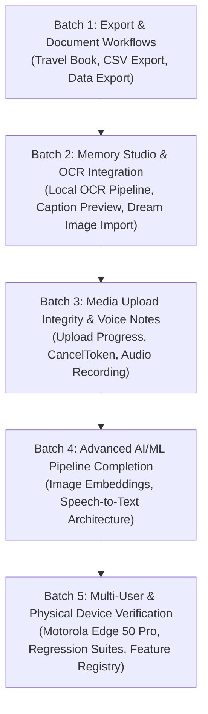

# SAFAR — Functional Completion & Engineering Roadmap

**Date:** 2026-11-22  
**Scope:** Actionable, dependency-aware engineering batches to systematically resolve all defects identified in the functional, AI/ML, and media audits.  
**Target Architecture:** Flutter Mobile + FastAPI Backend + Supabase PostgreSQL 17 + Local Staging Services.

---

## 1. Prioritization Principles & Safety Constraints

To protect product stability, the roadmap strictly enforces:
1. **Safety First:**
   - No production deployment.
   - No remote git pushes or tag creations.
   - No destruction or reset of seeded demo data.
   - No weakening of RLS, HMAC media signing, or CSRF/Session protections.
   - No interruption of running background services (Web `:3000`, API `:8000`, Staging `:8020`).
2. **First Stop Point Respected:**
   - This roadmap constitutes the comprehensive audit and remediation proposal.
   - Large architectural modifications, external library additions, and database migrations will be executed only after approval of these batches.
3. **Dependency-Aware Ordering:**
   - Fix broken existing client workflows first (Travel book, CSV/data exports).
   - Resolve UI-backend feature parity next (Dream import images, caption previews, audio notes).
   - Address heavy AI/ML pipelines (OCR, image embeddings, STT) with appropriate model/dependency selection.
   - Verify on physical Motorola Edge 50 Pro before sign-off.

---

## 2. Dependency-Aware Implementation Batches

---

### Batch 1: Document & Export Integrity (Highest Priority)
**Objective:** Eliminate raw source code and raw text dumps in modal sheets; convert all exports into real, usable artifacts.

| Target Feature | Precise Defect | Root Cause | Implementation Plan | Tests Required |
|---|---|---|---|---|
| **F18 (F44 in prompt)** Journey Replay Travel Book | Tapping "Open travel book" displays raw HTML source code in `SelectableText`. | Flutter client lacks document viewer or browser intent; no file is saved to disk. | 1. Add `path_provider` and `url_launcher` to `pubspec.yaml`. 2. In `ReplayScreen`, write fetched HTML to `${cacheDir}/travel_book_{tripId}.html`. 3. Offer two explicit actions: **View in Browser** (via `launchUrl`) and **Share Document** (via `SharePlus.instance.shareXFile`). 4. Ensure print stylesheet `@media print` renders cleanly when printed from browser. | `test/travel_book_export_test.dart` Verify file creation, MIME type `text/html`, and share dispatch. |
| **F13** Group Expenses CSV Export | "Export CSV" displays raw CSV string in `SelectableText`. | No file creation or native share sheet integration. | 1. In `ExpensesScreen`, write CSV string to `${cacheDir}/expenses_{tripId}.csv`. 2. Dispatch native Android share sheet via `SharePlus.instance.shareXFile(..., mimeType: 'text/csv')`. 3. User can open directly in Google Sheets or save to Downloads. | `test/expenses_export_test.dart` Verify CSV formatting, RFC 4180 headers, and share call. |
| **F01** Personal Data Export | "Export data" displays raw JSON string in `SelectableText`. | No file creation or native share sheet integration. | 1. In `SettingsScreen`, write JSON to `${cacheDir}/safar_user_data_export.json`. 2. Dispatch native share sheet with `application/json`. | `test/data_export_test.dart` Verify complete export serialization and share dispatch. |

---

### Batch 2: Memory Studio Core & OCR Integration
**Objective:** Activate real optical character recognition, enable image-based inspiration imports, and connect caption previews.

| Target Feature | Precise Defect | Root Cause | Implementation Plan | Tests Required |
|---|---|---|---|---|
| **F17** Dream Import (Image Support) | `_ImportSheet` only allows "Note" and "Link"; "Image" is missing from mobile UI. | UI affordance was omitted during initial Flutter migration. | 1. Add "Image" chip to `_ImportSheet`. 2. Integrate `image_picker` to select photos of flyers, itineraries, or travel guides. 3. Upload image via `ApiClient.upload` and send `source_type='image'` with `media_url` to `/api/trips/{id}/inspirations`. | `test/dream_import_image_test.dart` Verify image picking, upload, and inspiration creation. |
| **F17 & F12** Optical Character Recognition (OCR) | Memory Studio displays `ocr: false`; Dream Import reports OCR unavailable. | Host machine lacks Tesseract binary; Python venv lacks `pytesseract` and `Pillow`. | **Dual Strategy:** 1. *Backend:* Add lightweight Python OCR or bundled portable Tesseract so backend can process uploaded images without remote vendor calls. 2. *Mobile (Recommended for Android):* Integrate `google_mlkit_text_recognition` in Flutter for instant on-device OCR with zero latency and complete offline capability. 3. Update `services/api/app/routers/memories.py` to reflect actual OCR availability. | `services/api/tests/test_ocr_integration.py` Verify text extraction from test image, confidence calculation, and fallback on blank image. |
| **F12 (F43 in prompt)** Caption Grounding Preview | Users cannot preview or regenerate AI/template captions before saving a memory. | Caption suggestion endpoint exists on backend (`POST .../caption`), but is not called in Flutter `_MemorySheet`. | 1. Add a "Suggest Caption" button in `_MemorySheet`. 2. Call `suggestCaption()` upon photo selection. 3. Populate the caption field with the grounded suggestion, allowing user editing before submission. | `test/caption_preview_test.dart` Verify caption generation, grounded template structure, and editability. |

---

### Batch 3: Media Upload Integrity & Voice Notes
**Objective:** Bring media capture and upload resilience to production quality.

| Target Feature | Precise Defect | Root Cause | Implementation Plan | Tests Required |
|---|---|---|---|---|
| **F11** Video & Audio Capture in Mobile | `MemoriesScreen` only supports photo picking; no video picking or voice note recording. | Flutter UI only wired `ImagePicker.pickImage()`. | 1. Add "Record Voice Note" action using `record` / `audioplayers` package in Flutter. 2. Add "Choose Video" using `ImagePicker.pickVideo()`. 3. Upload audio as `audio/webm` or `audio/wav` and video as `video/mp4` to `/api/trips/{id}/media`. | `test/media_capture_types_test.dart` Verify MIME detection, magic byte validation on backend, and playback in timeline. |
| **F11** Upload Progress & Cancellation | Uploading large media files provides no percentage feedback and cannot be aborted. | `ApiClient.upload()` does not expose `onSendProgress` or accept `CancelToken`. | 1. Update `ApiClient.upload()` to accept `onSendProgress: (sent, total)` and `CancelToken`. 2. Update `_MemorySheet` to show a linear progress bar with percentage. 3. Add "Cancel" button to abort in-flight uploads. | `test/upload_progress_test.dart` Verify progress callback triggers and CancelToken aborts request. |

---

### Batch 4: Advanced AI/ML Pipeline Completion
**Objective:** Address advanced intelligence requirements (Image Embeddings and Speech-to-Text).

| Target Feature | Architecture Options | Recommended Approach | Implementation Requirements |
|---|---|---|---|
| **F12** Image Embeddings | 1. Cloud Vision API (violates local-first rule). 2. Heavy PyTorch CLIP model (too large for local environment). 3. Lightweight ONNX MobileNet / ViT model. | **Option 3: Lightweight ONNX Feature Extractor** running in Python backend or mobile on-device vector generation. | 1. Install `onnxruntime` and a compact visual embedding model in backend venv. 2. Generate 512-dim vector for each uploaded trip photo. 3. Store vector in `trip_memories.embedding` (PostgreSQL float array or pgvector). 4. Implement `/api/trips/{id}/memories/similar` cosine similarity search endpoint. |
| **F12** Speech-to-Text (STT) | 1. Cloud Speech API (requires external key). 2. Local Whisper model (Whisper-tiny via `faster-whisper` / ONNX). 3. On-Device Android Speech Recognition. | **Option 3 + Option 2 Fallback:** Native on-device speech recognition via Flutter `speech_to_text` package with backend Whisper-tiny fallback. | 1. Add `speech_to_text` to Flutter for real-time transcription on Motorola device. 2. Populate transcription text into memory draft for user review before saving. |

---

### Batch 5: Comprehensive Physical Verification & Sign-Off
**Objective:** End-to-end multi-user validation on physical device, automated test runs, and final registry updates.

1. **Physical Device Workflow Verification (Motorola Edge 50 Pro):**
   - Test Travel Book generation $\to$ open in Chrome $\to$ print to PDF.
   - Test Shared Expenses $\to$ Export CSV $\to$ open in Google Sheets.
   - Test Photo upload $\to$ on-device OCR $\to$ caption preview $\to$ timeline rendering.
   - Test Voice memo recording $\to$ transcription review $\to$ memory creation.
2. **Automated Test Execution:**
   - Run backend test suite: `pytest services/api/tests/`.
   - Run Flutter test suite: `flutter test apps/mobile/test/`.
   - Verify zero regressions and zero broken routes.
3. **Documentation Updates:**
   - Update `docs/FEATURE_REGISTRY.md` to reflect verified statuses.
   - Update `SAFAR_MASTER_SPECIFICATION.md` if any schemas were enhanced.

---

## 3. Decisions & Approvals Required

Before commencing execution of the proposed batches, the following engineering decisions require approval:

1. **Dependency Ingestion for Batch 1 (Mobile):**
   - Approval to add `url_launcher: ^6.3.1` and `path_provider: ^2.1.5` to `apps/mobile/pubspec.yaml` to enable native document rendering and file sharing.
2. **OCR Architecture Strategy for Batch 2:**
   - **Recommendation:** Implement on-device OCR via `google_mlkit_text_recognition` in Flutter (fastest, private, zero-dependency on Windows host), alongside a backend fallback.
3. **Voice Recording Strategy for Batch 3:**
   - Approval to add `record: ^6.2.0` (or compatible lightweight audio recorder) to `apps/mobile/pubspec.yaml` for voice memories.
4. **Image Embedding Scope for Batch 4:**
   - Clarification on whether to implement local ONNX vector embeddings or keep image embeddings explicitly disclosed as disabled until server GPU/vector infrastructure is provisioned.
