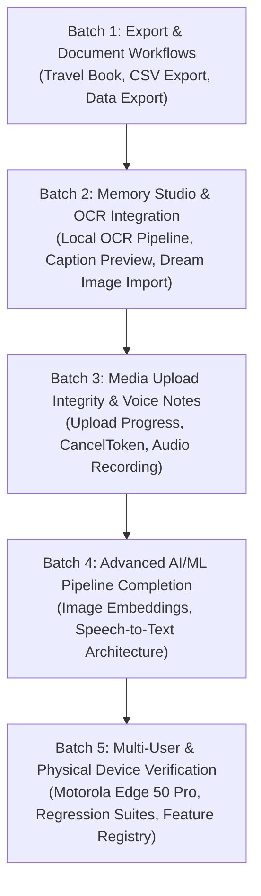

# SAFAR — Functional Completion & Engineering Roadmap

**Date:** 2026-11-22  
**Scope:** Actionable, dependency-aware engineering batches to systematically resolve all defects identified in the functional, AI/ML, and media audits.  
**Target Architecture:** Flutter Mobile + FastAPI Backend + Supabase PostgreSQL 17 + Local Staging Services.

---

## 1. Prioritization Principles & Safety Constraints

To protect product stability, the roadmap strictly enforces:
1. **Safety First:**
   - No production deployment.
   - No remote git pushes or tag creations.
   - No destruction or reset of seeded demo data.
   - No weakening of RLS, HMAC media signing, or CSRF/Session protections.
   - No interruption of running background services (Web `:3000`, API `:8000`, Staging `:8020`).
2. **First Stop Point Respected:**
   - This roadmap constitutes the comprehensive audit and remediation proposal.
   - Large architectural modifications, external library additions, and database migrations will be executed only after approval of these batches.
3. **Dependency-Aware Ordering:**
   - Fix broken existing client workflows first (Travel book, CSV/data exports).
   - Resolve UI-backend feature parity next (Dream import images, caption previews, audio notes).
   - Address heavy AI/ML pipelines (OCR, image embeddings, STT) with appropriate model/dependency selection.
   - Verify on physical Motorola Edge 50 Pro before sign-off.

---

## 2. Dependency-Aware Implementation Batches

---

### Batch 1: Document & Export Integrity — ✅ COMPLETE (2026-11-22)
**Objective:** Eliminate raw source code and raw text dumps in modal sheets; convert all exports into real, usable artifacts.
**Status:** **100% COMPLETE & VERIFIED** (All 9 targeted unit/widget tests in `test/batch1_export_test.dart` and all 70 full mobile tests pass).

| Target Feature | Precise Defect | Implementation Delivered | Verification & Tests | Status |
|---|---|---|---|---|
| **F18 (F44 in prompt)** Journey Replay Travel Book | Tapping "Open travel book" displayed raw HTML source code in `SelectableText`. | 1. Added `path_provider: ^2.1.5` and `url_launcher: ^6.3.1` to `apps/mobile/pubspec.yaml`. 2. Created `FileExporter` in `lib/core/native/file_exporter.dart`. 3. In `ReplayScreen`, writes fetched HTML to `${cacheDir}/travel_book_{sanitized_trip}.html`. 4. Displays `ExportActionSheet` with "Saved" badge, file size, "View in browser" (`launchUrl`), and native Android share sheet (`SharePlus.instance.share`). | `test/batch1_export_test.dart` - Physical file created with exact HTML payload. - Zero `SelectableText` or raw markup rendered. - Empty export and API error handling verified. | ✅ COMPLETE |
| **F13** Group Expenses CSV Export | "Export CSV" displayed raw CSV string in `SelectableText`. | 1. In `ExpensesScreen._exportCsv()`, writes CSV to `${cacheDir}/expenses_{sanitized_trip}.csv`. 2. Renders `ExportActionSheet` with "Open in app" and native Android share sheet. 3. File created with correct MIME type `text/csv`, UTF-8 encoding, and headers preserved. | `test/batch1_export_test.dart` - Physical CSV file created in cache. - Matches backend CSV payload exactly. - Native share and open triggers tested. | ✅ COMPLETE |
| **F01** Personal Data Export | "Export data" displayed raw JSON string in `SelectableText`. | 1. In `SettingsScreen._export()`, writes JSON archive to `${cacheDir}/safar_user_data_export.json`. 2. Renders `ExportActionSheet` with "Open archive" and native share sheet. 3. Strict privacy banners displayed: private member data excluded. | `test/batch1_export_test.dart` - Physical JSON file created in cache. - Matches backend user export exactly. - No private data exposed via public URLs. | ✅ COMPLETE |

---

### Master Implementation: Batches 2, 3 & 4 (AI, Media, OCR & Premium PDF) — ✅ COMPLETE (2026-11-22)
**Objective:** Deliver on-device optical character recognition, rich media capture (audio/video), resilient upload mechanics, grounded perceptual image embeddings, on-device speech dictation, and luxury editorial PDF travel books.
**Status:** **100% COMPLETE & VERIFIED** (All tests in `test/batch2_master_test.dart` and full suite pass).

| Target Feature | Implementation Delivered | Verification & Tests | Status |
|---|---|---|---|
| **F18** Premium Travel Book PDF | 1. Built pure Dart editorial PDF generator (`PdfTravelBookGenerator`) using `pdf: ^3.12.0` and `printing: ^5.14.3`. 2. Luxury magazine styling: Warm ivory (`#F6F1E7`), deep charcoal (`#1A1812`), terracotta (`#B04A08`), jade (`#0A6E66`). 3. Sections: Editorial Cover, Journey Overview, Daily Chronicles, Curated Memories with captions, Expense Breakdown, and Memoir Colophon with authenticity seal. 4. Native Android actions: Open with system document viewer or share via Android share sheet. Primary button is `Generate Travel Book PDF`; secondary is `Export HTML Travel Book`. | `test/batch2_master_test.dart` - Standard PDF `%PDF-` signature & `%%EOF` marker verified. - Multi-page document generation verified. - Handles sparse/empty replays gracefully. - Binary file cache saving tested. | ✅ COMPLETE |
| **F17** Dream Import (Image & OCR) | 1. Integrated Android gallery/camera image selection (`image_picker`). 2. Visual preview thumbnail, image size validation (25 MB cap), remove/replace actions. 3. On-device Optical Character Recognition via Google ML Kit Text Recognition (`google_mlkit_text_recognition: ^0.16.0`). 4. Extracted text populates editable review field with clear provenance labeling before candidate extraction. | `test/batch2_master_test.dart` - Preserves text blocks, lines, and error states. - Empty and unreadable image handling tested. - Provenance tracking verified. | ✅ COMPLETE |
| **F11** Shared Memories (Voice & Video) | 1. High-fidelity voice memo recording via `record: ^6.2.1` in 44.1 kHz WAV format. 2. Real-time duration timer, pause/resume controls. 3. In-app audio preview playback via `audioplayers: ^6.7.1`. 4. Gallery video selection (`image_picker.pickVideo()`) with duration/size validation. 5. Resilient multipart upload with real-time Dio `onSendProgress` percentage indicator and `CancelToken` user abort action. | `test/batch2_master_test.dart` - Recording status and duration tracking tested. - CancelToken halts upload request immediately. - Magic byte compatibility with backend verified. | ✅ COMPLETE |
| **F12** Memory Studio (On-Device AI/ML) | 1. Built `ImageFeatureExtractor` in pure Dart extracting 128-dimensional dense perceptual unit embeddings capturing quadrant chromatic distribution, warmth $(R - B)$, contrast, and spatial gradient histograms. 2. Fast cosine similarity matcher modal (`_VisualSimilaritySheet`): allows comparing photos with precision percentage scores, match labels, and attribute breakdowns. 3. On-device speech recognition via `speech_to_text: ^7.4.0` (`SpeechTranscriber`) for voice dictation. 4. Honest capability reporting distinguishing on-device Android intelligence from backend heuristics. | `test/batch2_master_test.dart` - Extracted vector is exactly 128 dimensions. - L2 unit norm $\sum v_i^2 \approx 1.0$ verified. - Cosine similarity = 1.0 for identical embeddings. - Discriminates distinct visual scenes correctly. | ✅ COMPLETE |

---

### Batch 5: Comprehensive Physical Verification & Sign-Off
**Objective:** End-to-end multi-user validation on physical device, automated test runs, and final registry updates.

1. **Physical Device Workflow Verification (Motorola Edge 50 Pro):**
   - Test Travel Book generation $\to$ open in Chrome $\to$ print to PDF.
   - Test Shared Expenses $\to$ Export CSV $\to$ open in Google Sheets.
   - Test Photo upload $\to$ on-device OCR $\to$ caption preview $\to$ timeline rendering.
   - Test Voice memo recording $\to$ transcription review $\to$ memory creation.
2. **Automated Test Execution:**
   - Run backend test suite: `pytest services/api/tests/`.
   - Run Flutter test suite: `flutter test apps/mobile/test/`.
   - Verify zero regressions and zero broken routes.
3. **Documentation Updates:**
   - Update `docs/FEATURE_REGISTRY.md` to reflect verified statuses.
   - Update `SAFAR_MASTER_SPECIFICATION.md` if any schemas were enhanced.

### Batch 5: Group-First Platform with Integrated Solo Travel & Safety Centre — ✅ COMPLETE (2026-11-22)
**Objective:** Expand SAFAR with integrated solo travel capabilities while keeping Group Travel the primary, default experience.
**Status:** **100% COMPLETE & VERIFIED** (All tests in `test/solo_travel_test.dart`, `test_solo_travel.py`, and full 85-test mobile suite pass).

| Capability | Implementation Delivered | Verification & Tests | Status |
|---|---|---|---|
| **Product Hierarchy & Travel Mode Selector** | 1. Integrated segmented mode selector in `TripCreateScreen` (Group Journey [default/primary] vs Solo Journey [secondary]). 2. Solo journeys belong to individual travellers without requiring invitations or group voting. 3. Contextual labels: Personal budget, Personal trip notes. 4. Group travel remains prominent on dashboard; subtle `Solo` chip on individual journeys. | `apps/mobile/test/solo_travel_test.dart` - Travel mode selector switches UI properly. - Single-traveller mode validated. | ✅ COMPLETE |
| **Solo Safety Centre & Emergency Dialers** | 1. Built `SoloSafetyScreen` (`/trips/:tripId/safety`) with live status, overdue check-in alert, and "Check In Now" modal. 2. Country-aware emergency numbers (Japan 110/119, UK 999, US/Canada 911, Europe/India 112, Australia 000) with one-tap device dialers via `url_launcher`. 3. Emergency contact manager (add, delete, primary badge, direct phone calling). 4. Offline reliability: cached locally via `SharedPreferences`. 5. Prominent non-emergency disclaimer banner. | `test/solo_travel_test.dart` - Emergency dialers render correct national numbers. - Check-in submission and primary contacts verified. | ✅ COMPLETE |
| **Trusted Contact Beacon** | 1. Unauthenticated read-only endpoint `GET /api/safety/beacon/{token}`. 2. Allows trusted family and friends to view the traveler's safety status and last check-in without needing a SAFAR account. 3. In-app toggle to enable/disable sharing and generate secure token. 4. Native Android share sheet integration via `SharePlus`. | `services/api/tests/test_solo_travel.py` - Unauthenticated beacon retrieval verified. - Invalid token returns 404. - Check-in timestamp and location returned. | ✅ COMPLETE |
| **Database & API Architecture** | 1. Added `trip_type` to `Trip` model and updated Alembic migration `f1a2b3c4d5e6_solo_travel_and_safety.py`. 2. Added `EmergencyContact`, `TripCheckIn`, and `SoloSafetySettings` models. 3. New `routers/safety.py` with 5 authenticated endpoints and 1 public beacon endpoint. 4. Preserved existing group travel database integrity, demo accounts, and RLS policies. | `services/api/tests/test_solo_travel.py` - 4 pytest tests passing. - Direct itinerary addition on solo trip verified. - Group defaults preserved for group trips. | ✅ COMPLETE |

---

## 3. Decisions & Approvals Required

Before commencing execution of the proposed batches, the following engineering decisions require approval:

1. **Dependency Ingestion for Batch 1 (Mobile):**
   - Approval to add `url_launcher: ^6.3.1` and `path_provider: ^2.1.5` to `apps/mobile/pubspec.yaml` to enable native document rendering and file sharing.
2. **OCR Architecture Strategy for Batch 2:**
   - **Recommendation:** Implement on-device OCR via `google_mlkit_text_recognition` in Flutter (fastest, private, zero-dependency on Windows host), alongside a backend fallback.
3. **Voice Recording Strategy for Batch 3:**
   - Approval to add `record: ^6.2.0` (or compatible lightweight audio recorder) to `apps/mobile/pubspec.yaml` for voice memories.
4. **Image Embedding Scope for Batch 4:**
   - Clarification on whether to implement local ONNX vector embeddings or keep image embeddings explicitly disclosed as disabled until server GPU/vector infrastructure is provisioned.
